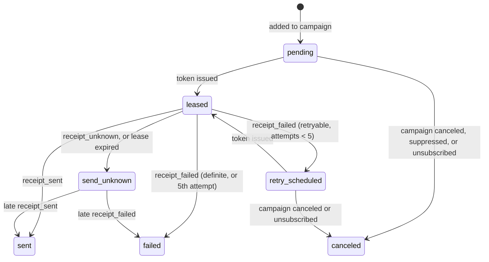

# pg-email-dispatcher

A Postgres-owned send pipeline for recruiter outreach. Recruiters send campaigns to candidates from their own Gmail mailboxes, and a recruiting team can share its company domain without one recruiter burning its reputation for everyone. The database decides which recruiter may send, when, and to which candidate; the worker only spends send tokens that Postgres has already issued, and hands every outcome back as a receipt.

It runs as a short serverless cron job (Vercel by default) against Supabase, and it is built around one rule: **a candidate never gets the same email twice because of a crash, a timeout, or two workers racing.**

## What it guarantees

- **One token, one recipient attempt.** A send can only happen after `dispatcher_claim_next_send_token` commits a lease, a token log row, and an attempt ledger row in one transaction. Two workers can never hold the same candidate.
- **Unknown beats duplicate.** If the worker cannot prove what the provider did (timeout, 5xx, dropped connection, a crash before the receipt), the recipient becomes `send_unknown` and is never retried automatically. A late receipt carrying the original token can still resolve it.
- **Stale receipts are rejected.** Every receipt must present the lease token that was issued. A replayed or out-of-date receipt raises instead of moving the wrong row.
- **Recruiter pacing and warmup.** Newly connected recruiter mailboxes ramp from 30 to 480 sends per rolling 24h, with a minimum gap between sends that starts at 10 minutes.
- **Domain protection.** Pacing caps apply per *reputation scope*: the individual mailbox for consumer domains (a recruiter's personal gmail.com or outlook.com), or the whole domain for company domains. Every recruiter on the team's `acme.com` domain shares one budget, so one recruiter's burst can't burn the domain for the rest of the team.
- **Safety pause.** When Gmail reports something a human must fix (API disabled, domain policy), the whole scope stops issuing tokens until an operator clears it.
- **Bounded retries.** Rate limits retry at the provider's `Retry-After`; the fifth retryable failure is terminal.
- **Unsubscribe that works.** Every send carries a stable per-address token, `List-Unsubscribe` and RFC 8058 one-click headers; when a candidate unsubscribes, unsent email to them is also canceled in campaigns that are already running.

## How it works


Each recipient row moves through this state machine; only Postgres functions move it:



A campaign completes on its own once nothing is `pending`, `retry_scheduled` or `leased`. The [architecture notes](docs/architecture.md) explain each decision and the invariant it protects.

### Warmup policy

Age is measured from a scope's first issued token, so connecting a mailbox and not sending does not burn warmup time. Edit `dispatcher_warmup_policy` to change the ramp.

| Scope age | Rolling 24h cap | Minimum gap between sends |
|---|---|---|
| 0–24h | 30 | 10 min |
| 24–72h | 60 | 5 min |
| 72h–7d | 150 | 4 min |
| 7–14d | 300 | 3 min |
| 14d+ | 480 | 3 min |

The worker's `WORKER_SENDER_MIN_INTERVAL_SECONDS` is a floor; the stricter of the two wins.

## Quickstart (local, no real email)

Requires Node 20+, Docker, and the [Supabase CLI](https://supabase.com/docs/guides/cli).

```bash
npm install
```

```bash
npm run db:start
```

```bash
cp .env.example .env
```

Put the `SERVICE_ROLE_KEY` printed by `db:start` into `SUPABASE_SERVICE_ROLE_KEY` in `.env`, then load the demo data (4 recruiters across 3 reputation scopes, 40 candidates) and run a cycle:

```bash
npm run db:reset
```

```bash
npm run dev
```

`SIMULATE_SENDS=true` (the default) swaps Gmail for a simulator that occasionally rate-limits (→ `retry_scheduled`) and returns 500s (→ `send_unknown`). You'll see one send per recruiter per cycle, then `no_work` while pacing holds the rest. Watch progress with:

```sql
select * from campaign_send_state;
select * from unknown_sends;
```

## Using it in your app

Everything is a service-role RPC; nothing is exposed to `anon` or `authenticated`.

1. **Recruiters and their mailboxes.** Insert one `senders` row per recruiter. After your Google OAuth callback (scope `https://www.googleapis.com/auth/gmail.send`, `access_type=offline`), store the tokens in Vault with `dispatcher_upsert_sender_credentials(sender_id, 'google', provider_email, access_token, refresh_token, expires_at, scopes)`.
2. **Campaigns.** Insert a `campaigns` row (`sender_id`, `name`, `subject`, `body_html`, optional `body_text` and `reply_to_email`). `{{first_name}}` and `{{unsubscribe_url}}` are filled per candidate.
3. **Candidates.** Upsert `contacts` from your ATS, sourcing tool or a CSV, then insert one `campaign_contacts` row per candidate while the campaign is a draft.
4. **Send.** `dispatcher_campaign_go_live(campaign_id, send_at)` drops suppressed addresses and schedules the rest. `dispatcher_pause_campaign`, `dispatcher_resume_campaign` and `dispatcher_cancel_campaign` do what they say; resume requires the recruiter's mailbox to be connected.
5. **Unsubscribe.** Deploy `api/unsubscribe.ts` and set `UNSUBSCRIBE_URL_BASE` to it. GET shows a confirm button (so link scanners can't unsubscribe people); POST records it via `dispatcher_record_unsubscribe`.
6. **Operate.** `campaign_send_state` rolls up each campaign. `unknown_sends` is the queue a person reconciles (check the recruiter's Sent folder). `dispatcher_admin_clear_safety_pause` and `dispatcher_admin_fast_forward_warmup` are audited escape hatches.

If a recruiter's mailbox disconnects (revoked grant, `dispatcher_disconnect_sender`), their live campaigns pause automatically. There is no auto-resume.

## Deploy

1. Link your Supabase project and push the migrations: `supabase link --project-ref <ref>` then `supabase db push`.
2. Deploy this repo to Vercel. `vercel.json` schedules `/api/cron/email-dispatcher` every 5 minutes, and the route allows up to 300s.
3. Set `SUPABASE_URL`, `SUPABASE_SERVICE_ROLE_KEY`, `CRON_SECRET`, `GOOGLE_CLIENT_ID`, `GOOGLE_CLIENT_SECRET`, `UNSUBSCRIBE_URL_BASE`, and `SIMULATE_SENDS=false`.

Running several workers at once is safe: they skip each other's locked recruiters and candidates instead of waiting.

## Configuration

See [.env.example](.env.example) for every variable and its default. The ones you'll most likely touch:

| Variable | Default | What it does |
|---|---|---|
| `SIMULATE_SENDS` | `true` | Use the Gmail simulator instead of the real API |
| `WORKER_DRAIN_BUDGET_MS` | `270000` | How long one cron invocation keeps claiming |
| `WORKER_SHUTDOWN_MARGIN_MS` | `30000` | Time left for the last send and receipt before the platform limit |
| `WORKER_RECIPIENT_LEASE_SECONDS` | `300` | How long a token is valid before it expires into `send_unknown` |
| `WORKER_SENDER_MIN_INTERVAL_SECONDS` | `180` | Floor on the gap between one recruiter's sends |
| `WORKER_DEFAULT_RETRY_DELAY_SECONDS` | `300` | Retry delay when the provider doesn't say |

## Tests

```bash
npm test
```

```bash
npm run test:db
```

`npm test` covers the worker loop, Gmail failure classification, the refresh-once path, MIME header safety and merge fields. `npm run test:db` runs the pgTAP suites against the local database: admission and pacing, shared domain caps, receipts and retry limits, unknown and late-receipt handling, lifecycle and unsubscribe, permissions, and a two-session concurrency test (via `dblink`) that holds real locks while the other session claims.

## Scope and limits

- Gmail is the only provider. The provider boundary is the receipt client, so adding Microsoft Graph or SMTP means a new `execute*Send` that records the same receipts.
- One workspace per database: recruiters and candidates aren't partitioned by agency or client. Add a tenant column to scopes and campaigns if several recruiting teams must be isolated from each other.
- `send_unknown` is resolved by a person or a late receipt; there is no automatic reconciliation against the provider's sent items.
- No bounce or complaint processing yet.

## License

[MIT](LICENSE)
