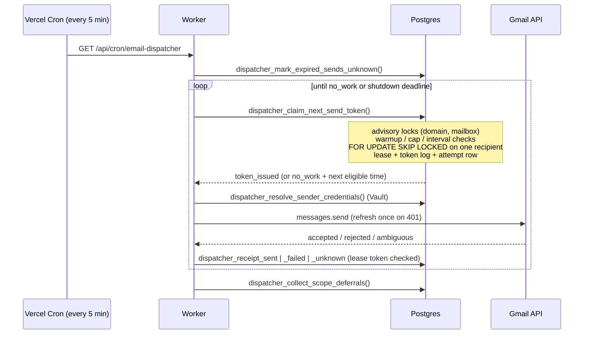
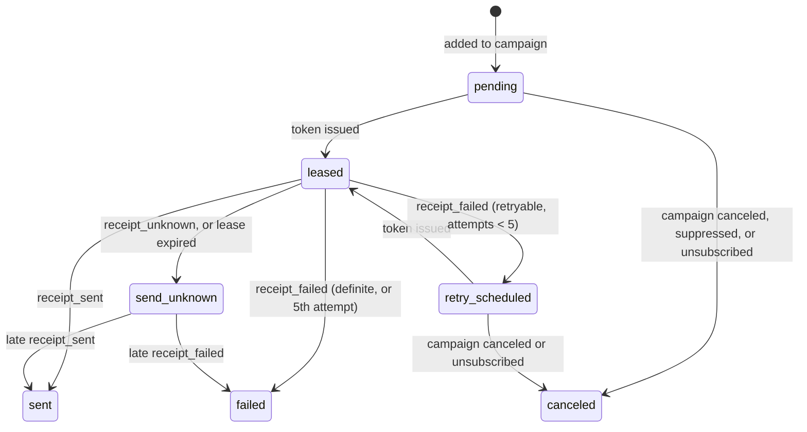

# pg-email-dispatcher

Outreach email for solo recruiters, solo entrepreneurs and small teams, sent from your own Gmail mailboxes without burning your domains.

The typical setup it is built for is **one mailbox per domain, across several domains**: a solo recruiter with `maya@acme-talent.com`, `maya@acmetalent.io` and `maya@hireacme.co`, or a three-person team that each has their own domain. Domain reputation is what mailbox providers punish, so the domain is what this rations. Volume comes from spreading sends across many domains, never from pushing one domain harder.

Postgres decides which mailbox may send, when, and to whom. The worker only spends send tokens the database has already issued, and hands every outcome back as a receipt. It runs as a short serverless cron job (Vercel by default) against Supabase, and it is built around one rule: **a person never gets the same email twice because of a crash, a timeout, or two workers racing.**

## Who it's for

| You are | Your setup | What the dispatcher does |
|---|---|---|
| A solo recruiter or founder | One mailbox on each of several domains | Warms up and paces each domain on its own, and drains across all of them so a new or capped domain doesn't stop the others |
| A small team | A few people, often each on their own domain, sometimes sharing one | Paces each domain as one unit: teammates on a shared domain share its budget, so one person's busy day can't burn it for everyone |
| A personal Gmail user | `you@gmail.com` | Treats the mailbox itself as the unit, since there's no domain of your own to protect |

It is not a cold-email SaaS with a UI. It is the sending engine underneath one: the database guarantees, the Gmail integration and the pacing policy, ready to run yourself or embed in your own tool.

## What it guarantees

- **One token, one recipient attempt.** A send can only happen after `dispatcher_claim_next_send_token` commits a lease, a token log row and an attempt ledger row in one transaction. Two workers can never hold the same recipient.
- **Unknown beats duplicate.** If the worker cannot prove what the provider did (timeout, 5xx, dropped connection, a crash before the receipt), the recipient becomes `send_unknown` and is never retried automatically. A late receipt carrying the original token can still resolve it.
- **Stale receipts are rejected.** Every receipt must present the lease token that was issued. A replayed or out-of-date receipt raises instead of moving the wrong row.
- **Domain-level budgets.** Caps apply per *reputation scope*: the whole domain for your own domains, or the individual mailbox for consumer addresses (gmail.com, outlook.com). Everyone sending from one domain shares its budget, deliberately.
- **Warmup.** A domain's budget starts small at its first send and grows with age, with a minimum gap between one mailbox's sends.
- **Multi-domain drain.** Each claim takes the first due recipient from every domain before the second from any, so sending is interleaved across all your domains.
- **Safety pause.** When Gmail reports something a human must fix (API disabled, domain policy), that domain (or personal mailbox) stops issuing tokens until an operator clears it.
- **Bounded retries.** Rate limits retry at the provider's `Retry-After`; the fifth retryable failure is terminal.
- **Unsubscribe that works.** Every send carries a stable per-address token, `List-Unsubscribe` and RFC 8058 one-click headers; unsubscribing also cancels unsent email to that person in campaigns already running.

## How it works



Each recipient row moves through this state machine; only Postgres functions move it:



A campaign completes on its own once nothing is `pending`, `retry_scheduled` or `leased`. The [architecture notes](docs/architecture.md) explain each decision and the invariant it protects, and the [pipeline walkthrough](docs/pipeline-walkthrough.html) draws it.

### Warmup policy

Age is measured from a domain's first issued token, so connecting a mailbox and not sending does not burn warmup time. Edit `dispatcher_warmup_policy` to change the ramp.

| Domain age | Rolling 24h cap | Minimum gap between sends |
|---|---|---|
| 0–24h | 30 | 10 min |
| 24–72h | 60 | 5 min |
| 72h–7d | 150 | 4 min |
| 7–14d | 300 | 3 min |
| 14d+ | 480 | 3 min |

These numbers came from opted-in email and are too generous for cold outreach at the top end; see [Known gaps](#known-gaps). The worker's `WORKER_SENDER_MIN_INTERVAL_SECONDS` is a floor on the gap; the stricter of the two wins. With one mailbox per domain, the per-mailbox gap and the domain's pace are the same thing.

## Quickstart (local, no real email)

Requires Node 20+, Docker, and the [Supabase CLI](https://supabase.com/docs/guides/cli).

```bash
npm install
```

```bash
npm run db:start
```

```bash
cp .env.example .env
```

Put the `SERVICE_ROLE_KEY` printed by `db:start` into `SUPABASE_SERVICE_ROLE_KEY` in `.env`, then load the demo data (4 mailboxes across 3 domains, 40 recipients) and run a cycle:

```bash
npm run db:reset
```

```bash
npm run dev
```

`SIMULATE_SENDS=true` (the default) swaps Gmail for a simulator that occasionally rate-limits (→ `retry_scheduled`) and returns 500s (→ `send_unknown`). You'll see one send per mailbox per cycle, then `no_work` while pacing holds the rest. Watch progress with:

```sql
select * from campaign_send_state;
select * from unknown_sends;
```

## Using it in your app

Everything is a service-role RPC; nothing is exposed to `anon` or `authenticated`.

1. **Mailboxes.** Insert one `senders` row per mailbox. After your Google OAuth callback (scope `https://www.googleapis.com/auth/gmail.send`, `access_type=offline`), store the tokens in Vault with `dispatcher_upsert_sender_credentials(sender_id, 'google', provider_email, access_token, refresh_token, expires_at, scopes)`.
2. **Campaigns.** Insert a `campaigns` row (`sender_id`, `name`, `subject`, `body_html`, optional `body_text` and `reply_to_email`). `{{first_name}}` and `{{unsubscribe_url}}` are filled per recipient.
3. **Recipients.** Upsert `contacts` from your ATS, CRM or a CSV, then insert one `campaign_contacts` row per recipient while the campaign is a draft.
4. **Send.** `dispatcher_campaign_go_live(campaign_id, send_at)` drops suppressed addresses and schedules the rest. `dispatcher_pause_campaign`, `dispatcher_resume_campaign` and `dispatcher_cancel_campaign` do what they say; resume requires the mailbox to be connected.
5. **Unsubscribe.** Deploy `api/unsubscribe.ts` and set `UNSUBSCRIBE_URL_BASE` to it. GET shows a confirm button (so link scanners can't unsubscribe people); POST records it via `dispatcher_record_unsubscribe`.
6. **Operate.** `campaign_send_state` rolls up each campaign. `unknown_sends` is the queue a person reconciles (check the mailbox's Sent folder). `dispatcher_admin_clear_safety_pause` and `dispatcher_admin_fast_forward_warmup` are audited escape hatches.

If a mailbox disconnects (revoked grant, `dispatcher_disconnect_sender`), its live campaigns pause automatically. There is no auto-resume.

**Today, one campaign sends from one mailbox.** To drain across several domains, create one campaign per mailbox and split the recipients between them; all of them send in parallel, each paced by its own domain. Spreading a single campaign across several mailboxes is the first item on the roadmap.

## Deploy

1. Link your Supabase project and push the migrations: `supabase link --project-ref <ref>` then `supabase db push`.
2. Deploy this repo to Vercel. `vercel.json` schedules `/api/cron/email-dispatcher` every 5 minutes, and the route allows up to 300s.
3. Set `SUPABASE_URL`, `SUPABASE_SERVICE_ROLE_KEY`, `CRON_SECRET`, `GOOGLE_CLIENT_ID`, `GOOGLE_CLIENT_SECRET`, `UNSUBSCRIBE_URL_BASE`, and `SIMULATE_SENDS=false`.

Running several workers at once is safe: they skip each other's locked domains, mailboxes and recipients instead of waiting.

## Configuration

See [.env.example](.env.example) for every variable and its default. The ones you'll most likely touch:

| Variable | Default | What it does |
|---|---|---|
| `SIMULATE_SENDS` | `true` | Use the Gmail simulator instead of the real API |
| `WORKER_DRAIN_BUDGET_MS` | `270000` | How long one cron invocation keeps claiming |
| `WORKER_SHUTDOWN_MARGIN_MS` | `30000` | Time left for the last send and receipt before the platform limit |
| `WORKER_RECIPIENT_LEASE_SECONDS` | `300` | How long a token is valid before it expires into `send_unknown` |
| `WORKER_SENDER_MIN_INTERVAL_SECONDS` | `180` | Floor on the gap between one mailbox's sends |
| `WORKER_DEFAULT_RETRY_DELAY_SECONDS` | `300` | Retry delay when the provider doesn't say |

## Tests

```bash
npm test
```

```bash
npm run test:db
```

`npm test` covers the worker loop, Gmail failure classification, the refresh-once path, MIME header safety and merge fields. `npm run test:db` runs the pgTAP suites against the local database: admission and pacing, shared domain caps, receipts and retry limits, unknown and late-receipt handling, lifecycle and unsubscribe, permissions, and a two-session concurrency test (via `dblink`) that holds real locks while the other session claims.

## Known gaps

What the dispatcher gets right today is the core of the model: the domain is the unit that gets rationed, and sending is interleaved across domains. These are the places where it falls short of how outreach from many domains actually works. The cold-email numbers below come from practitioner guides ([Growthflare](https://growthflare.io/blog/how-many-cold-emails-per-day/), [Ozigi](https://ozigi.app/blog/how-many-cold-emails-per-day-without-spam), [Litemail](https://litemail.ai/blog/how-many-email-inboxes-do-you-need-for-cold-email-in-2026)) and are rules of thumb, not provider limits.

### Deliverability policy

- **Subdomains get their own budget.** The scope key is everything after the `@`, so `outreach.acme.com` and `acme.com` are paced separately. Gmail is widely reported to add up a domain's volume together with its subdomains' ([MailReach](https://www.mailreach.co/blog/gmail-sender-guidelines)), and a flagged inbox is known to drag down its siblings on the same domain, which is why people who want isolation buy separate domains. The key should be the registrable domain (`acme.com`, via the public suffix list).
- **The ramp is tuned for opted-in mail.** Cold-outreach guidance is roughly 30–50 sends per day for a new domain and 100–250 for a warmed one, and about 20–30 per inbox. The current ceiling of 480 per domain, and per personal Gmail mailbox, is far above that. The policy should be chosen per campaign or workspace (cold outreach versus opted-in), not one hard-coded function.
- **No per-mailbox cap under the domain cap.** For your own domains there is only the domain budget plus the gap between one mailbox's sends. With one mailbox per domain that's enough; for a team sharing a domain, each inbox should also have its own daily ceiling.
- **Pacing reacts to time, not to trouble.** The `cooling_down` state exists but nothing sets it; only a Gmail operator-action error changes behavior (safety pause). Bounces, spam complaints and the domain's spam rate (Google expects under 0.3%) aren't read. A domain should cool down automatically when its bounce rate spikes.
- **Domains never wear out.** A domain reaches "warmed" and stays there. Cold-sending domains lose reputation over 6–12 months of use, so a multi-domain setup needs a lifecycle: warm, active, resting, retired.

### Multi-domain drain

- **One campaign, one mailbox.** A campaign has one `sender_id` and a sender has one active mailbox. Draining a single campaign across your domains means splitting it into one campaign per mailbox. See [Roadmap](#roadmap).
- **Two sender rows can connect the same mailbox.** The 24h cap is shared (it follows the mailbox), but the gap between sends is per sender row, so that mailbox could send twice as often as intended.

### Worker

- **The time budget is checked before a claim, not before a send finishes.** One token can take about 80s in the worst case (send timeout, OAuth refresh, resend), more than the 30s shutdown margin. A claim late in a run can be cut off by the platform and surface as a false `send_unknown`. The worker should only claim while a worst-case send still fits, and config should reject a lease shorter than that worst case.
- **The sweep-then-late-receipt path isn't tested directly.** The tests cover an explicit unknown followed by a late receipt, not an expired lease followed by one.

### Adopting it

- **No "connect Gmail" flow.** The repo stores OAuth tokens but doesn't include the redirect and callback that obtains them.
- **Tables live in `public` with generic names** (`campaigns`, `contacts`, `senders`), which collide with most existing apps. They should move to a `dispatcher` schema.
- **Supabase only.** It relies on `auth.role()`, the `service_role` role and Supabase Vault.
- **Gmail only.** The provider boundary is the receipt client, so Microsoft Graph or SMTP means a new `execute*Send` that records the same receipts.
- **One workspace per database.** Recipients and mailboxes aren't partitioned by client or team.
- **`send_unknown` is resolved by a person or a late receipt;** there is no automatic reconciliation against the mailbox's Sent folder.

## Roadmap

The direction is many domains, one mailbox each, drained as one pool.

1. **Inbox rotation: one campaign across several mailboxes.** A `campaign_senders` table lists the mailboxes a campaign may use (its `sender_id` is the default one-mailbox pool). The claim picks whichever eligible mailbox in the pool is ready soonest. Locks, warmup, caps, `SKIP LOCKED` and receipts stay as they are, since they already work per mailbox and per domain. `campaign_send_state` stays one row per campaign with a per-mailbox breakdown, and a paused or capped mailbox drops out of the pool without stopping the campaign. Pacing moves from the sender row to the connected mailbox, which also closes the shared-mailbox gap.
2. **Registrable-domain scopes and a cold-outreach policy,** including a per-mailbox cap under each domain's budget.
3. **Feedback-driven cooldowns** from bounces and complaints, and a domain lifecycle that rests and retires worn domains.
4. **The worker fixes:** claim only while a worst-case send fits, and validate the lease against it.
5. **Easier adoption:** a `dispatcher` schema and a Google connect flow.

## License

[MIT](LICENSE)
